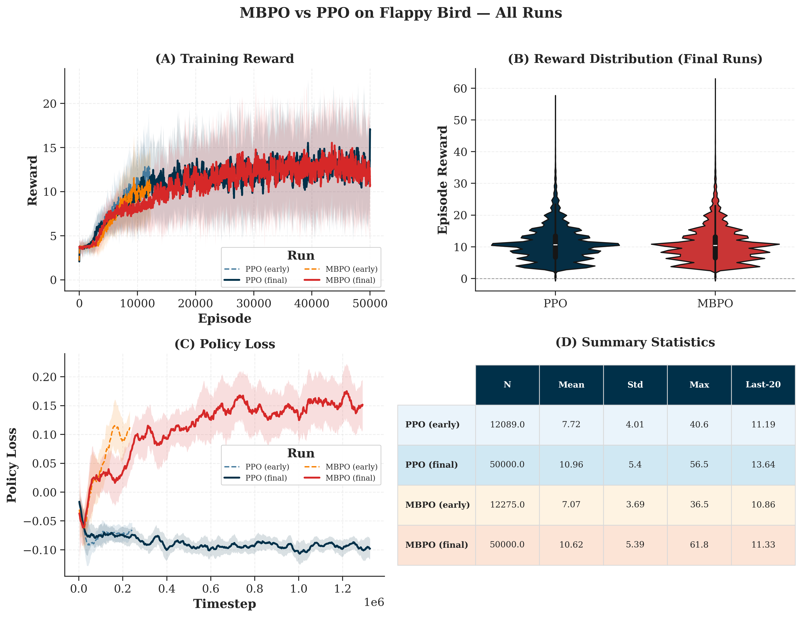

# flappy-bird-mbrl

A practical comparison of model-free and model-based RL on Flappy Bird.

## Abstract

I built this project to answer a simple question: in this Flappy Bird setup, does a model-based approach actually beat a PPO baseline in a meaningful way?

The repo keeps the final code, selected notebooks, and result artifacts that support that comparison. I kept earlier iterations where useful, but the focus here is on the runs and files that back the final claims.

## Methodology

Setup in short:
- Same game/environment family for all methods
- PPO as the model-free baseline
- MBPO-style variants as model-based candidates (including feature-only and JAX versions)
- Same style of reward logging and metadata export for comparison

Important caveat:
- This is an engineering benchmark, not a full statistical study across many random seeds. The results are still useful, but should be interpreted as strong empirical evidence rather than a universal ranking.

## Benchmark Summary

Based on preserved run metadata:

| Model | Episodes | Average Reward (last 100) | Max Reward |
|---|---:|---:|---:|
| MBPO (best run) | 50,000 | 12.265 | 61.8 |
| PPO (reference) | 50,000 | 10.94 (mean eval) | 20.0 |

Source files:
- results/best_mbpo_metadata.json
- results/ppo_reference_metadata.json
- results/benchmark_summary.json

## Benchmark Figure



Why the reward values appear in vertical "columns":
- Flappy Bird rewards are partly discrete events (especially pipe passes and terminal penalty), not fully continuous outcomes.
- With frame skipping and fixed per-step shaping, many episodes collapse to similar totals.
- So the distribution is not smooth by design; the bands are a real property of the reward function, not a plotting artifact.

## Repository Structure

- src/: training/evaluation code and smoke tests
- notebooks/: original experimental notebooks
- flappy_bird_repo/: game environment dependency used by agents
- results/: benchmark artifacts and metadata
- scripts/: utility scripts for result reporting

## Final Notebook Set

Curated notebooks used for the final comparison:
- notebooks/flappy_bird_mbpo.ipynb: final MBPO benchmark source notebook
- notebooks/flappy_bird_ppo.ipynb: PPO benchmark/baseline notebook
- notebooks/flappy_bird_comparison.ipynb: comparative analysis notebook

## Quick Start

1. Create and activate a virtual environment.
2. Install dependencies:

```bash
pip install -r requirements.txt
```

3. Run PPO training:

```bash
python src/flappy_bird_ppo.py
```

4. Run smoke tests:

```bash
python src/test_mbpo_v5_smoke.py
python src/test_mbpo_v6_smoke.py
```

5. Generate a benchmark report from metadata:

```bash
python scripts/summarize_results.py
```

## Final Result Bundle

The results/ directory contains the main evidence for the reported outcomes:
- benchmark_summary.json: consolidated comparison values
- best_mbpo_metadata.json: final MBPO metrics snapshot
- ppo_reference_metadata.json: final PPO reference metrics
- fig4_combined_panel.png: benchmark figure used in the README

## Notes for Recruiters

What this project shows in practice:
- Practical deep RL engineering (PPO, world models, vectorized environments)
- Iterative debugging and experimentation across multiple MBPO versions
- Reproducibility habits: checkpoints, metadata, and smoke tests
- Cross-framework work in PyTorch and JAX

## Attribution

The game implementation under flappy_bird_repo/ is adapted from an external Flappy Bird RL codebase included in this workspace, with its own LICENSE retained.

## License

This project is licensed under the MIT License. See LICENSE.
